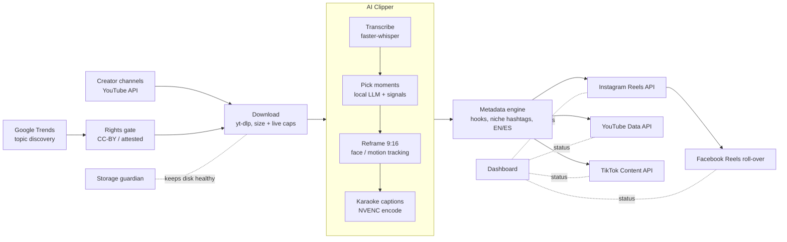

# Autonomous short-form video pipeline

[](https://github.com/SiahJJ/short-form-video-pipeline/actions/workflows/tests.yml)

A self-hosted system that finds trending and creator videos, cuts them into vertical shorts with AI, writes
captions and hashtags, and publishes to **Instagram Reels, YouTube Shorts, TikTok and Facebook Reels**,
unattended, on one Windows PC with a consumer GPU.

> 400+ clips published across four platforms · runs 24/7 on scheduled tasks · fully local AI (no paid LLM APIs)

## What it does



## Highlights

| Area | What's interesting |
|---|---|
| **Clip selection** | A local LLM (Qwen3 via Ollama) ranks transcript moments. Free signals nudge the scores: YouTube's "most replayed" heatmap, audio energy peaks, and scene-cut snapping so clips don't open mid-shot. |
| **Reframing** | YuNet face tracking with two-pass EMA smoothing for talking heads; a motion-based tracker prototype for sports (optical flow, camera-pan compensation, scene-cut reset). |
| **Metadata** | A hashtag engine builds candidates from titles, YouTube tags, transcripts, visual evidence and Google Trends. It detects the clip's niche (gaming, news, tennis, trading…) and guarantees that community's tags. Spanish sources get bilingual hooks with a grounding check that rejects words not supported by the source. |
| **Publishing safety** | Idempotent ledgers per platform. An upload whose outcome is uncertain is **never retried automatically** (no double posts). Cadence gates follow each platform's limits (Instagram 50 per 24 h, Facebook 30 per 24 h, YouTube daily quota), with an end-of-day burst to use the unused allowance. |
| **Content policy** | Creative Commons licence verification through the YouTube API, a publication cutoff date, and English/Spanish language and shopping/ads content filters, all enforced before anything is posted. |
| **Reliability** | Windows Task Scheduler with hidden launchers, single-instance locks, watchdogs, and a storage guardian. The guardian deletes only what every platform has confirmed, hard-links duplicate sources, and pauses downloads below a free-space floor. |
| **Security** | OAuth tokens are encrypted at rest with Windows DPAPI. Secrets are entered through masked prompts and never logged. Logins use local callback servers with state checks. |
| **Observability** | A read-only dashboard (Python, stdlib HTTP) shows queues, last posts, cadence, storage and scheduled-task health. |

## Tech stack
Python · Node.js · PowerShell · FFmpeg (NVENC) · OpenCV · faster-whisper · Ollama (Qwen3, Qwen3-VL) ·
SQLite · yt-dlp · Instagram Graph API · YouTube Data API v3 · TikTok Content Posting API ·
Facebook Graph API (Reels) · Google Trends · Windows Task Scheduler / DPAPI

## Code

The modules below are extracted from the production system and generalised: no machine paths, account IDs or
credentials. Each is covered by tests.

| Module | What it shows |
|---|---|
| [`src/clip_signals/signals.py`](src/clip_signals/signals.py) | Scoring clips with free evidence: YouTube "most replayed" heatmap, audio-energy z-scores, scene-cut snapping |
| [`src/metadata/hashtags.py`](src/metadata/hashtags.py) | Tag hygiene (accent folding, no glued franchise tags, no dangling phrases), niche detection, guaranteed community tags |
| [`src/metadata/hooks.py`](src/metadata/hooks.py) | Bilingual LLM caption hooks with a **grounding check** that rejects invented facts, then retries or gives up |
| [`src/publishing/ledger.py`](src/publishing/ledger.py) | Ledger-first idempotent publishing: a lost publish answer becomes `uncertain` and is never auto-retried |
| [`src/publishing/cadence.py`](src/publishing/cadence.py) | Posting under a rolling 24 h cap: even pace, backlog gaps, end-of-day burst |
| [`src/publishing/facebook_reels.py`](src/publishing/facebook_reels.py) | Facebook Reels Graph API client (start → binary upload → finish → poll) |
| [`src/publishing/secret_store.py`](src/publishing/secret_store.py) | OAuth tokens encrypted at rest with Windows DPAPI |
| [`src/storage/guardian.py`](src/storage/guardian.py) | Rule-ordered disk cleanup that only deletes what every consumer has confirmed; aborts on unknown state |
| [`src/storage/dedupe.py`](src/storage/dedupe.py) | Atomic hard-link dedupe: duplicate multi-GB sources stored once |
| [`src/ranking/priority.py`](src/ranking/priority.py) | Per-platform prioritisation: YouTube best-score-first with peak-hour `publishAt`, Instagram priority with trend, staleness and a shrunk creator-performance bonus |
| [`src/reframe/motion_reframe.py`](src/reframe/motion_reframe.py) | Sports 16:9 → 9:16 reframing prototype: optical flow with camera-pan compensation, cut detection, camera-operator smoothing |
| [`src/dashboard/helper_server.py`](src/dashboard/helper_server.py) | Phone helper for TikTok inbox drafts: caption copy, range-streamed previews, CSRF-guarded "mark posted" |
| [`ops/`](ops) | Wake-capable hidden scheduled tasks, stay-awake wrapper, edge-triggered email alerts, backup archiver |

```bash
pip install numpy pytest
python -m pytest -q        # 32 tests
```

## Guides
- [architecture.md](docs/architecture.md): components, data flow, state
- [operations.md](docs/operations.md): **waking the PC on schedule, keeping the disk from filling up, notifications**
- [remote-access-tailscale.md](docs/remote-access-tailscale.md): **public video URLs with Tailscale Funnel, a private phone dashboard with Tailscale Serve**
- [tiktok-helper.md](docs/tiktok-helper.md): **TikTok inbox uploads and the phone helper for captions**
- [prioritization.md](docs/prioritization.md): **how the AI score, trends and past performance decide what posts where, first**
- [publishing-safety.md](docs/publishing-safety.md): ledgers, idempotency, cadence, content gates
- [lessons-learned.md](docs/lessons-learned.md): real incidents and the fixes that stop them recurring

All examples use placeholders (`<host>.<tailnet>.ts.net`, `<sender address>`, `<pipeline folder>`).

Credentials, account data and media are never committed.
