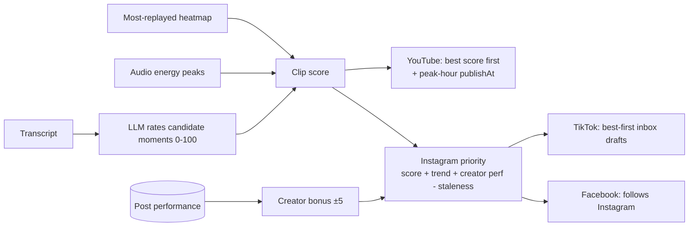

# How clips are prioritised for each platform

Each platform has a different budget: YouTube about 10 uploads a day, Instagram 50, Facebook 30, and TikTok a
few drafts at a time. The pipeline produces more clips than that, so the order matters. Every clip gets one
quality score, and each platform ranks by it in the way that fits its limits.

## 1. The clip score (0–100)
1. **The LLM rates moments.** A local LLM reads the transcript and proposes candidate clips, each scored for
   hook strength, a self-contained story, payoff and energy. A strict rubric keeps the model from rating
   everything 85+.
2. **Free evidence nudges the rating** ([`src/clip_signals`](../src/clip_signals/signals.py)):
   - **Most replayed:** YouTube's audience-retention heatmap. Up to +6 when the clip covers the moments viewers
     rewatch, and slightly negative for the least-watched stretches.
   - **Energy:** up to +3 when the clip's loudest moments (laughter, cheering) stand well above the video's
     own voiced baseline.
3. Low-scoring candidates are dropped before rendering, which saves GPU time and disk.

## 2. Platform rankings ([`src/ranking/priority.py`](../src/ranking/priority.py))

| Platform | Rule | Why |
|---|---|---|
| **YouTube** | Strictly highest score first. Source-video views break ties. Unscored clips go last. | The daily quota is tiny, so only the best clips get it. |
| | Each upload gets a scheduled **`publishAt` in the next free peak-hour slot**. | Uploads happen whenever the PC is awake; videos go live when the audience is. |
| **Instagram** | `priority = score + 5 (trending topic) + creator bonus (±5) − staleness (1 per day after day 3, max 10)` | Timely topics are worth more while they're hot; old sources fade instead of clogging the queue. |
| | Only the **top 25** may publish; the rest wait and rejoin as better clips post. | A short active queue keeps old clips from blocking new ones. |
| **TikTok** | Best-first, a few drafts at a time. | TikTok refuses inbox uploads once a handful are pending. |
| **Facebook** | Rolls over Instagram-confirmed Reels in Instagram's order. | It inherits the ranking and the content gates. |

Gates are checked **before** ranking and override everything: rights, language, shopping/ads content, and the
publication cutoff. A blocked clip can rank first and still never publish.

## 3. Learning from performance
The **creator bonus** is the feedback loop: creators whose posted clips out-perform the account's average
rank higher, and under-performers rank lower.
- It uses a z-score against all posts, halved and clipped to ±1, then scaled to ±5.
- It is **shrunk by n / (n + 8)**, so a creator with 1 viral post moves the ranking far less than one with 30
  consistently good posts.
- Below 20 posts in total it does nothing: no data means no guessing.

### Performance loop v2 ([`src/analytics/performance.py`](../src/analytics/performance.py))
1. **Collect.** Every published post, with its features (creator, niche, trend vs creator clip, length, hook
   style, posting hour, language), gets metric snapshots at **24 h and 72 h**, so posts are compared at the same
   age. Views come from YouTube and Facebook; Instagram uses likes + 3×comments until the insights
   permission is granted.
2. **Learn.** The outcome is log(views) minus the platform median: a lift that is comparable across platforms.
   Each factor value's mean lift is shrunk by n/(n+8).
3. **Act.**
   - The creator bonus (±5) in ranking now comes from views across platforms, not likes alone.
   - The **best posting hours choose when the PC wakes up to post** (see
     [operations.md](operations.md#work-windows)).
   - A weekly report lands in the notification digest.

What it found on the first run (real account, aggregated):
- Clips **under 20 s** do best and **over 60 s** worst.
- A few creators clearly out- or under-perform.
- Evening and mid-morning beat late night, which is where an even 24-hour pace had been putting many posts.

## Example (synthetic)
| Clip | Score | Trend | Creator bonus | Source age | Priority |
|---|---|---|---|---|---|
| Breaking-news clip | 80 | +5 | 0 | 1 day | **85** |
| Gaming highlight | 82 | – | 0 | 2 days | **82** |
| Podcast moment | 88 | – | 0 | 20 days (−10) | **78** |

The podcast clip has the highest raw score but the stalest source, so the fresh news clip posts first.
