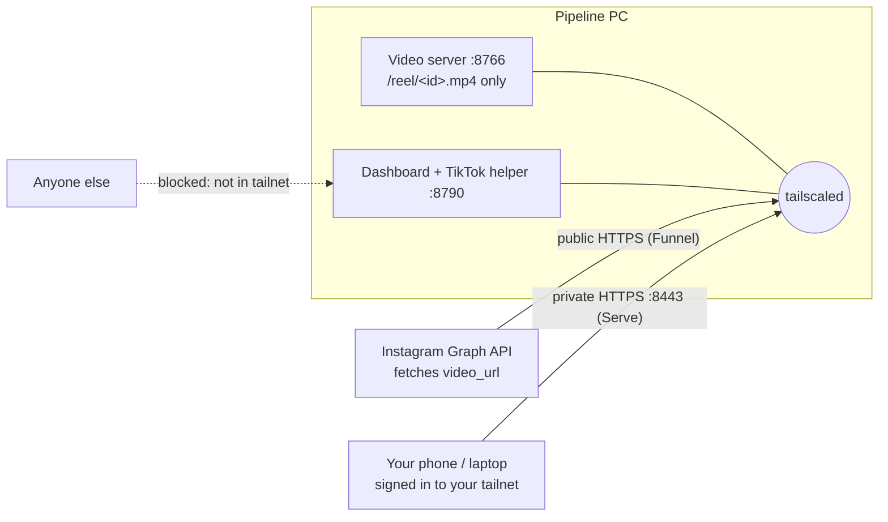

# Remote access with Tailscale: public video URLs and a private phone dashboard

The whole pipeline runs on one PC behind a normal router. Two things still need to be reachable from
outside:

1. **Instagram's servers** must download each Reel from a **public HTTPS URL**: the Graph API takes a
   `video_url`, not a file upload.
2. **You, on your phone,** want to check the dashboard and use the TikTok helper from anywhere, but nobody else
   should be able to.

Tailscale solves both with no port forwarding, no static IP, no reverse-proxy box and no certificate renewal.



## 1. Public, read-only video URLs with Tailscale Funnel

```bash
# expose ONLY the local video server on the public internet, with automatic HTTPS
tailscale funnel --bg 8766
# -> https://<host>.<tailnet>.ts.net/  ->  http://127.0.0.1:8766
```

The publisher then hands Instagram a URL like `https://<host>.<tailnet>.ts.net/reel/412.mp4`.

How the video server is kept safe enough to be public:
- It serves **one folder** of already-optimised Reel files by numeric ID. There is no directory listing, no
  path parameters and no uploads.
- It is read-only, and files are only there while a Reel is queued; the storage guardian removes them after
  every platform confirms.
- Before each publishing session the runner checks that both local services (`:8000` OAuth/publisher and
  `:8766` video server) answer, and publishes nothing if they don't. This avoids Instagram's
  "media could not be fetched" container failures.

## 2. A private dashboard with Tailscale Serve (tailnet-only)

```bash
# HTTPS on :8443, reachable only by devices signed in to your tailnet - NOT public
tailscale serve --bg --https=8443 http://127.0.0.1:8790
# -> https://<host>.<tailnet>.ts.net:8443/   (open it on your phone with the Tailscale app on)
```

`tailscale serve status` should show the dashboard as **(tailnet only)** and only the video server under
**Funnel on**:

```
https://<host>.<tailnet>.ts.net (Funnel on)
|-- / proxy http://127.0.0.1:8766

https://<host>.<tailnet>.ts.net:8443 (tailnet only)
|-- / proxy http://127.0.0.1:8790
```

The dashboard itself is defence-in-depth, not just "hidden":
- **Reads are read-only.** SQLite is opened with `mode=ro`; queues and ledgers are only read.
- **Writes are tiny and guarded.** The only write (marking a TikTok clip as posted) accepts `POST` only
  when `Origin` is the dashboard's own origin (localhost or the tailnet URL) **and** a custom `X-Dashboard`
  header is present. A random web page can't forge that header cross-origin, so CSRF is blocked even for
  someone on your tailnet.
- **No secrets in responses.** Tokens never leave the encrypted store; log lines are scrubbed before being
  shown.

## Why Tailscale instead of the alternatives
| Option | Problem it avoids |
|---|---|
| Router port-forwarding + dynamic DNS | Exposes your home IP; TLS certificates to manage; every port is public |
| ngrok-style tunnels | Random or paid subdomains; another account; URLs change |
| Cloud bucket for videos | Upload step + storage cost; a second copy of every file |
| **Tailscale Funnel + Serve** | One stable HTTPS name, automatic certificates, per-port public/private choice, phone access through the same tailnet |

## Troubleshooting
- **Instagram container `ERROR` / media fetch failed:** check `tailscale funnel status` and that `:8766`
  answers locally (`curl -I http://127.0.0.1:8766/reel/<id>.mp4`).
- **Phone can't open the dashboard:** the Tailscale app must be connected on the phone, and the URL needs the
  `:8443` port.
- **A dashboard button does nothing:** the request came from an origin that isn't allowed (for example, an IP
  address instead of the `ts.net` name). Use the exact tailnet URL.
