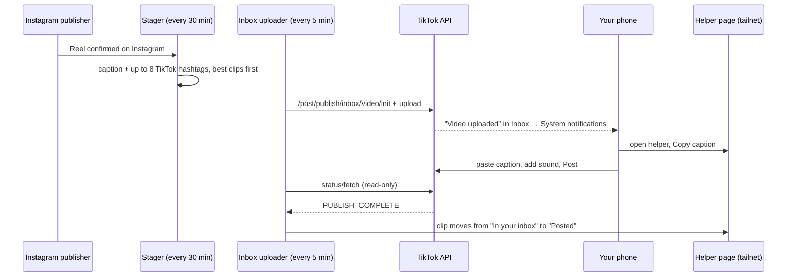

# TikTok: inbox uploads + a phone helper for captions

TikTok's Content Posting API has two modes. **Direct Post** publishes immediately, but requires an
app audit before posts can be public. **Inbox upload** needs no audit: the video lands as a draft in the
creator's TikTok app. The catch is that inbox uploads **carry no caption**, so a human has to finish each post.
The TikTok helper makes that a 15-second job from your phone.

## What the helper page does
Served by the dashboard (`/tiktok`) and opened on your phone over the private tailnet URL
(see [remote-access-tailscale.md](remote-access-tailscale.md)):

- **In your TikTok inbox:** every clip that's been delivered as a draft, newest first, with an inline video
  preview (HTTP range streaming, so it scrubs on mobile), the ready caption, **Copy caption** and **Posted**.
- **Waiting to send:** staged clips by day, best first, with size, caption and a link to the Instagram original.
- **In your TikTok inbox** lists exactly what TikTok's status endpoint reports as waiting (refreshed every 5
  minutes), not the helper's own checkmarks, which drifted from the app.
- Posting is **detected automatically**: the uploader polls TikTok's status endpoint and marks a clip posted
  once TikTok reports `PUBLISH_COMPLETE`, so the **Posted** button is only a manual override.

## Pacing and TikTok's pending-draft limit
TikTok refuses new inbox uploads (`spam_risk_too_many_pending_share`) once a handful of drafts are waiting
unposted. The uploader:

- sends at most one clip per gap, best clips first;
- **stops sending at the pending limit** and emails one reminder ("N drafts waiting, post them to
  resume");
- resumes on its own as soon as you post a draft;
- treats an explicit TikTok rejection *before* a `publish_id` exists as safe to retry later (nothing was
  created).

## Lesson learned: reconcile "unknown" uploads, never re-send them
An upload's final `PUT` can return an error (we saw HTTP 403) even though TikTok accepted the file. Those
items were marked `outcome_unknown` and, by design, never re-sent, but they were also **never re-checked**.
The uploader counted 0 waiting drafts while TikTok counted 3, so every new upload was refused for 7 hours.

Fix: `outcome_unknown` items that have a `publish_id` are included in the read-only status reconciliation.
`SEND_TO_USER_INBOX` moves them to "In your inbox" and `PUBLISH_COMPLETE` to "Posted". Nothing is ever
uploaded twice; the state just stops lying.

## Lesson learned: count pending drafts the way TikTok does
The gate first counted "drafts waiting" from the helper's own checkmarks. Two things broke that:
- **Checkmarks aren't TikTok's state.** Tapping **Posted** on the helper, or uploading the file yourself,
  doesn't publish the inbox draft. TikTok kept counting those drafts, while the gate thought 0 were waiting.
- **Invisible "ghost" uploads.** Two uploads TikTok reported as `SEND_TO_USER_INBOX` never appeared in the
  app, so the creator couldn't clear them.

Fix (`PENDING_TRUTH_V1`):
- Every run asks TikTok's status endpoint which recent uploads are still `SEND_TO_USER_INBOX`, ghosts
  included, and gates on **that** number.
- When blocked, it **probes once an hour**. A refused init creates nothing, so probing is harmless, and it
  catches drafts TikTok has expired while its status endpoint still lists them.
- The reminder email names exactly which drafts are blocking, marks ghosts as "not visible, will expire",
  and is never sent for 0.
- A ghost's clip is re-queued as a fresh upload. That's safe because the original never reached the creator.

## Lesson learned: a stale count can freeze the hold
After a refusal the uploader holds for an hour, lifting early "as soon as the pending count drops". Two bugs
combined into an hour of idling with an almost-empty inbox:
- Right after the PC woke, status checks failed (the network wasn't up yet) and were counted as "not
  pending". The count read 1 when TikTok had 4.
- The hold stored that wrong 1 as its baseline, so "drops below 1" could never happen, even after the
  creator posted 3 drafts.

Fix (`HOLD_FIX_V1`):
- A failed status check keeps the last known state instead of meaning "posted".
- A refusal re-reads the true count.
- The hold's baseline rises to the largest count it sees, so posting any draft lifts it.
- The gate's limit is set to what TikTok actually enforces for the account (4 here), so the uploader stops
  before it gets refused.

## Minimal implementation
[`src/dashboard/helper_server.py`](../src/dashboard/helper_server.py) is a self-contained version of the
helper's server side: a CSV checklist, range-streamed previews, and an origin- and header-guarded "mark
posted" endpoint, with tests.
